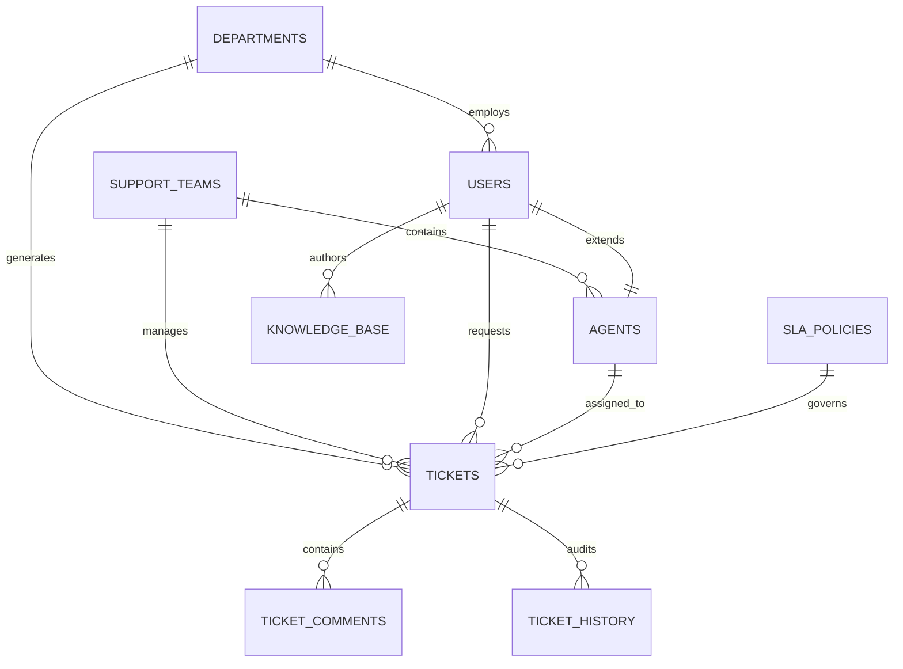

# 🛡️ IT ServiceDesk Pro - SQL-Driven IT Helpdesk & SLA Intelligence System

A full-stack, SQL-powered IT Helpdesk and Ticket Management System built with **Python**, **Streamlit**, **MySQL**, **Pandas**, and **Plotly**. Designed for enterprise organizations to manage employee support requests, track lifecycle transitions, enforce Service-Level Agreements (SLAs), auto-balance agent workloads, and deliver advanced SQL-driven workforce intelligence.

---

## 🚀 Key Features

### 1. 🔐 Role-Based Access Control (RBAC) & Multi-Role Portals
- **IT Admin & Executive Portal**: Full operational analytics, KPI scorecards, SLA policy tuning, agent management, and database configuration.
- **Support Agent & Team Lead Queue**: Ticket triage with live SLA countdown badges, workload balancing, internal notes, and canned response templates.
- **Employee Requester View**: Fast ticket submission with AI auto-triage, interactive ticket lifecycle timeline, and 5-star CSAT feedback collection.

### 2. 🎫 Comprehensive Ticket Lifecycle Management
- **Full State Machine**: `Open` ➔ `Assigned` ➔ `In Progress` ➔ `Pending Customer` ➔ `Resolved` ➔ `Closed` (with `Reopened` state tracking).
- **Intelligent Workload-Aware Auto-Assignment**: Automatically routes incidents to the least-loaded available agent in the specialized department team.
- **Audit Logging & Timeline**: Every state change, priority shift, agent assignment, and note is audited in the `ticket_history` table.

### 3. ⏱️ Advanced SLA Intelligence & Breach Prevention
- **Dynamic SLA Policies**: Configurable response, resolution, and escalation thresholds for `Critical`, `High`, `Medium`, and `Low` priority tickets.
- **Live SLA Countdown Matrix**: Real-time status indicators flagging **SLA Met**, **Approaching Breach (< 2 hours)**, and **Breached Overdue**.
- **Automated Root-Cause Tracking**: Captures defect analysis and root causes for breached and reopened tickets.

### 4. 📈 Advanced SQL Analytics & Workforce Intelligence
- **Agent Performance Scorecards**: SQL Common Table Expressions (CTEs) and Window Functions (`RANK() OVER (...)`, `DENSE_RANK()`, `AVG() OVER (...)`).
- **Recurring Problem & Pareto Analysis**: Identifies top defect categories and failure trends using `GROUP BY` and `HAVING`.
- **Department Workload Matrix**: Demand share across business units.
- **Team Overload & Capacity Gauges**: Real-time utilization percentages.

### 5. 🤖 AI-Powered Incident Assistant
- **Smart Priority & Category Suggestion**: Analyzes incident text for urgency and domain.
- **Similar Issue & Duplicate Search**: Compares incoming issues against historical tickets and displays past resolutions.
- **Knowledge Base Recommendations**: Suggests matching self-service KB articles.

### 6. 📄 1-Click Executive Reporting
- **Executive PDF Report**: Styled summary report ready for management review.
- **Multi-Tab Excel Master Dossier**: Styled workbook containing Summary, Tickets, Agent Rankings, Department Demand, and SLA Compliance.

### 7. 🗄️ Dual-Engine Relational Database Architecture
- **MySQL 8.0+ Primary Engine**: Native support for MySQL with connection pooling.
- **SQLite Engine**: Zero-configuration setup with automatic schema creation and realistic enterprise dataset seeding.

---

## 🗄️ Relational Schema Diagram



---

## 🛠️ Tech Stack & SQL Concepts

| Layer | Technology |
|---|---|
| **Frontend UI** | Streamlit, Custom Glassmorphic CSS |
| **Data Engine & Analytics** | MySQL 8.0+, SQLite 3, SQLAlchemy, Pandas, Plotly |
| **Reporting & Export** | ReportLab (PDF), XlsxWriter / OpenPyXL (Excel) |
| **SQL Concepts Used** | Primary/Foreign Keys, Normalization, CTEs (`WITH`), Window Functions (`RANK`, `DENSE_RANK`), `GROUP BY`, `HAVING`, `CASE WHEN`, Subqueries, Date Arithmetic (`TIMESTAMPDIFF`, `DATE_ADD`), Indexes, Views |

---

## 🏃 Quick Start Guide

### 1. Install Dependencies
```bash
pip install -r requirements.txt
```

### 2. Seed the Database
Populates 5 departments, 4 support teams, 10 user accounts, SLA policies, and 30+ enterprise tickets:
```bash
python database/seed_data.py
```

### 3. Run the Streamlit Application
```bash
streamlit run app.py
```

### 4. Default Demo Accounts (Password: `admin123`)
- **IT Administrator**: `admin@enterprise.com`
- **CIO / Executive**: `cio@enterprise.com`
- **L2 Support Agent**: `alice.chen@enterprise.com`
- **L3 Cloud Ops Agent**: `brian.t@enterprise.com`
- **Employee (Sales)**: `michael.s@enterprise.com`

---

## 🧪 Running Unit Tests
```bash
python -m unittest tests/test_sql_engine.py
```
